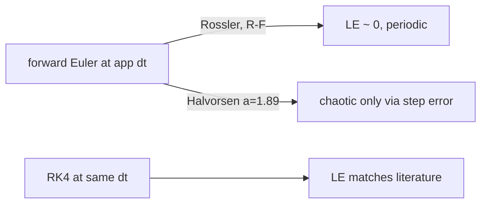

# Page 1 - Classics

Textbook systems at textbook parameters. Every continuous flow has `integrator: 'rk4'`; Hénon is a map. Source: `createClassicAttractors()` in `constants.ts`, calculators in `attractorCalculations.ts`. LE = vet measurement under the app's own stepping.

| type | Equations (before *dt) | Params | dt | LE | Notes |
|------|------------------------|--------|----|----|-------|
| lorenz | x'=σ(y-x), y'=x(ρ-z)-y, z'=xy-βz | σ=10 ρ=28 β=8/3 | 0.008 | 0.91 | |
| rossler | x'=-y-z, y'=x+ay, z'=b+z(x-c) | a=b=0.2 c=5.7 | 0.02 | 0.070 | periodic under Euler at this dt |
| henon | x<-1-ax²+y, y<-bx | a=1.4 b=0.3 | 0 | 0.42/iter | dots, 1 iteration per 20 sub-steps |
| chua | x'=α(y-x-f(x)), y'=x-y+z, z'=-βy | α=15.6 β=28 m0=-1.143 m1=-0.714 | 0.02 | 0.44 | |
| sprott | x'=a(y-x), y'=xz, z'=b-y² | a=2.07 b=1.79 | 0.015 | 0.22 | |
| four_wing | x'=ax+yz, y'=bx+cy-xz, z'=-z-xy | a=0.2 b=0.01 c=-0.4 | 0.03 | 0.064 | |
| rabinovich | x'=y(z-1+x²)+γx, y'=x(3z+1-x²)+γy, z'=-2z(α+xy) | α=1.1 γ=0.87 | 0.01 | 0.20 | small basin, see below |
| halvorsen | x'=-ax-4y-4z-y² (cyclic) | a=1.4 | 0.01 | 0.69 | |
| dadras | x'=y-px+qyz, y'=ry-xz+z, z'=sxy-ez | p=3 q=2.7 r=1.7 s=2 e=9 | 0.002 | 0.41 | |
| aizawa | (see attractorInfo) | a=.95 b=.7 c=.6 d=3.5 e=.25 f=.1 | 0.01 | 0.094 | |



## Rabinovich-Fabrikant basin
At α=1.1, γ=0.87 the attractor's basin is small: (0.1, 0.1, 0.1) diverges, and the default 0.02 swarm spacing puts points 6-9 outside it. The roster uses:
```ts
points: initPoints(-1, 0, 0.5, color, 0.005), home: { x: -1, y: 0, z: 0.5 }, center: { x: -1.17, y: 1.01, z: 0.59 }
```
`home` must stay inside the basin, or every reset diverges again.

## Rationale and lessons
- Under Euler at these dt, Rössler and R-F collapse onto periodic orbits; lowering dt to <= 0.005 fixes Rössler but slows it 4x on screen. RK4 keeps the visual speed and costs 4 calculator calls per sub-step (negligible next to the trail-grid paint).
- Halvorsen's former a=1.89 was chaotic only because of Euler error; under RK4 it is periodic. Never tune a classic against Euler.
- Swarm spacing is a basin parameter, not cosmetics.

Related: [summary.md](summary.md), [integration.md](integration.md), [vetting.md](vetting.md)
