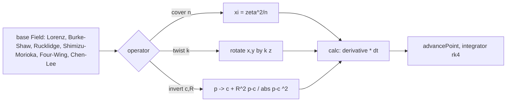

# Page 4 - the forge

Ten flows built from known chaotic bases by smooth coordinate operators. Each one is `calc(operator(base))` in `src/components/attractors/forgeCalculations.ts`, and the roster is `createForgeAttractors()` in `constants.ts`.

## Operators
| Operator | Params | Velocity | Requirement |
|----------|--------|----------|-------------|
| `cover` | `n` | xi' = (2/n) xi^(1-n/2) zeta', z' unchanged | base symmetric under (x,y,z) -> (-x,-y,z); singular on the z-axis |
| `twist` | `twist` | R(kz) f(R(-kz)p) + k z' (-y, x) | none |
| `invert` | `cx, cy, cz, R` | R^2 (v r^2 - 2q(q.v)) / r^4 at base point q | c off the attractor |

## Roster
| Type | Base | Operator | dt | LE | View |
|------|------|----------|----|----|------|
| trefoil | Lorenz | cover 3 | 0.004 | 0.91 | top-down |
| starfish | Lorenz | cover 5 | 0.004 | 0.91 | top-down |
| compass | Burke-Shaw | cover 8 | 0.003 | 0.70 | top-down |
| lantern | Chen-Lee | invert (0,0,-2) R 10 | 0.003 | 0.14 | x-z plane (`TILT(pi/2)`) |
| crown | Rucklidge | cover 4 | 0.006 | 0.20 | top-down |
| conch | Lorenz | invert (15,0,25) R 15 | 0.004 | 0.90 | oblique |
| lotus | Shimizu-Morioka | cover 6 | 0.01 | 0.063 | top-down |
| triskele | Four-Wing | cover 3 | 0.02 | 0.065 | top-down |
| quatrefoil | Chen-Lee | cover 4 | 0.002 | 0.13 | top-down |
| galaxy | Rucklidge | cover 3 + twist 0.3 | 0.006 | 0.20 | top-down |

## Invariants
- Conjugacy: LE must equal the base's LE. A mismatch means a wrong Jacobian.
- Covers are seeded with `liftToCover()`; `home` = seed for every entry.
- Inversion seeds come from a point already on the base attractor (a raw seed's transient arcs out of the tile).
- `TILT(dx)` = `FACE_CAMERA` + dx on x, a clean screen-x tilt (see [../engine/projection.md](../engine/projection.md)).
- Badge `forge`, credit `ORIGINAL_CREDIT`, shared `FORGE_NOTE`.

Related: [summary.md](summary.md), [vetting.md](vetting.md), [integration.md](integration.md)
