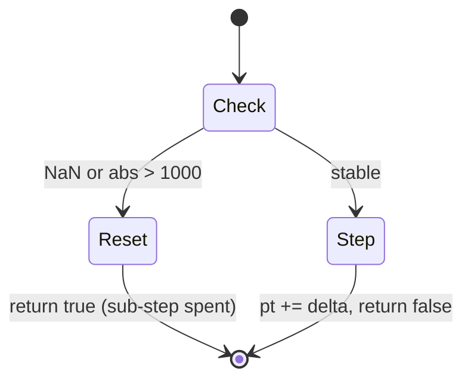

# Integration

`advancePoint(sys, pt, ctx?)` in `attractorCalculations.ts` is the only continuous-flow step. The render loop (`engine/drawAttractors.ts`), the worker and the vet script all call it, so what is vetted is what ships.

```ts
export const advancePoint = (sys: Steppable, pt: Point3D, ctx?: StepContext): boolean => {
    if (!isPointStable(pt)) { resetPoint(pt, sys.home); return true; }   // guard FIRST
    const calc = calculators[sys.type];
    if (!calc) return false;
    const d = sys.integrator === 'rk4' ? rk4Delta(calc, pt, sys.params) : calc(pt, sys.params, ctx);
    pt.x += d.dx; pt.y += d.dy; pt.z += d.dz;
    return false;
};
```



## Contract
- Returns `true` when the point was reset; `drawTrails` lifts the pen (`moveTo`) so no line is drawn to `home`.
- `Steppable = { type, params, integrator?, home? }` so plain objects (worker snapshots, vet clones) work.
- RK4 builds on calculators that return `f(pt)*dt`: each stage delta is already `k_i * h`. One shared scratch point avoids allocation. Only pure calculators qualify.
- Effective simulated time per frame per point = `subSteps * dt` (perf preset × SPEED).

## Rationale
- Guard-first is required: computing the delta before the guard and adding it after a reset re-poisons the point with NaN forever (the former latch bug).
- RK4 per attractor, not globally: originals were tuned under Euler and would change character.

## Lessons
- A stability guard that runs after the delta is computed is a silent sink: NaN points just stop drawing, nothing errors.

Related: [classic.md](classic.md), [../engine/frame.md](../engine/frame.md), [vetting.md](vetting.md)
