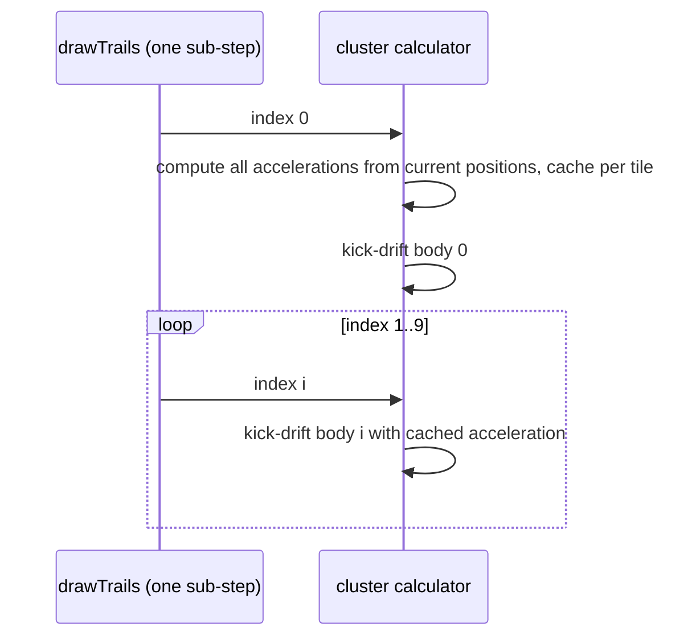

# Page 3 - Menagerie

Ten different classes of dynamics through the same tile pipeline. Source: `menagerieCalculations.ts`, `createMenagerieAttractors()`. Most are hidden-state systems: the real state lives in module-level `WeakMap`s; `pt` is only the plotted projection.

| type | Class | Draw | State beyond `pt` |
|------|-------|------|-------------------|
| thicket | IFS chaos game, 4 affine maps | dots /2 | none (random map choice) |
| dendrite | Julia set z²+c by inverse iteration, c=-0.4+0.6i | dots /2 | none (random sqrt branch) |
| colony | Langton's ants on a shared 160x160 torus | dots /2 | per-tile lattice (keyed by points array), ant heading |
| stadium | Bunimovich billiard | trail | velocity |
| pendulum | double pendulum, internal RK4 | trail | angles + angular velocities |
| cluster | softened N-body in a harmonic bowl, kick-drift | trail | velocity; per-tile shared accelerations |
| echo | Mackey-Glass delay eq., delay embedding | trail | 4096-sample history |
| murmuration | boids in a soft box | trail | velocity |
| loom | three incommensurate frequencies (quasi-periodic, not chaotic) | trail | phase |
| rebound | ball on vibrating plate, drawn on drive-phase cylinder | trail | height, velocity, phase |

```ts
const bodyStore = new WeakMap<object, Body>();               // per point
const clusterStore = new WeakMap<object, ClusterShared>();   // per tile, keyed by ctx.points
const b = stateOf(bodyStore, pt, () => ({ vx, vy, vz }));    // lazy init on first step
```



## Invariants
- Interacting systems (cluster, murmuration, colony) require sub-step-major stepping; see [../engine/frame.md](../engine/frame.md).
- `ctx` is optional: `ctxOf(pt, ctx)` falls back to a single-point context (vet LE pass, worker).
- Never add fields to `Point3D`; never normalise velocity to a constant when a wall force must turn the agent (cap it).
- Flat systems use `FACE_CAMERA` (+ `z: π` to flip up).
- Page 3 cannot run in the worker: its protocol carries no `StepContext`.

## Lessons
- With point-major stepping, Cluster integrated each body against a frozen swarm and stale cached accelerations; energy grew until bodies were ejected (~330 resets per 3000 frames, r≈1400). The single-point vet LE pass could not see it; the swarm column now does.
- LE numbers for this page are rough hints only (they track one plotted point).

Related: [summary.md](summary.md), [vetting.md](vetting.md)
