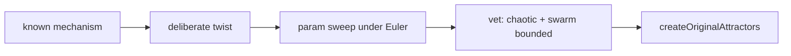

# Page 2 - Originals

Ten flows (one map) invented for the project, each a twist on a known chaos mechanism. Parameters were chosen by sweep **under forward Euler at the listed dt**, so they keep the default `integrator` ('euler'). Switching them to RK4 changes their dynamics and requires re-vetting. Source: `originalCalculations.ts`, `createOriginalAttractors()`.

| type | Mechanism | Key params | dt | LE |
|------|-----------|-----------|----|----|
| sigil | Lorenz with cos(wz) gain | a=10 b=30 c=8/3 w=0.6 | 0.008 | 1.36 |
| wick | Lorenz with an \|xy\| pump on z | a=4 b=40 c=1 | 0.008 | 1.02 |
| cinder | Chua with tanh diode | a=15.6 b=28 m0=-1.5 m1=-0.3 | 0.01 | 0.73 |
| gyre | Dadras + cos(x) ripple on z | a=3 b=2.7 c=2.5 d=4 e=9 k=0.5 | 0.005 | 0.98 |
| moth | jerk-like flow, y·tanh(y) thermostat | a=4 b=5 c=0.1 | 0.015 | 0.20 |
| tidepool | planar rotation, radius dialled by z | a=3 b=0.2 c=5 d=0.05 e=4 | 0.01 | 0.28 |
| ossuary | Nosé-Hoover + k·sin(wx) forcing | a=1 k=1 w=5 | 0.01 | 0.14 |
| ripple | 3D sine/cosine map (dots) | a=2.24 b=0.43 c=-0.65 d=-2.43 e=0.6 | 0 | 0.39/iter |
| anvil | jerk: sinusoidal kick vs cubic brake | a=1.2 b=0.2 k=2 | 0.01 | 0.11 |
| reed | jerk with sqrt restoring force | a=0.7 b=2 c=0.2 k=2 | 0.01 | 0.10 |

## Invariants
- `center` is set for off-origin orbits (wick z≈38.7, sigil z≈2.4, gyre, reed) from the vet mean.
- Credit line `Claude · for The Record · 2026`, `badge: 'original'`. Novelty is not certified (no literature search).

## Lessons
- Ossuary at k=2 measured LE 0.002 (quasi-periodic, Nosé-Hoover tori) and passed the old gate because `weak` was not a failure. k=1 gives 0.14. The gate now requires `chaotic`.
- Conservative/thermostat systems sit near KAM tori; check LE from several seeds, not one.

Related: [summary.md](summary.md), [vetting.md](vetting.md)
