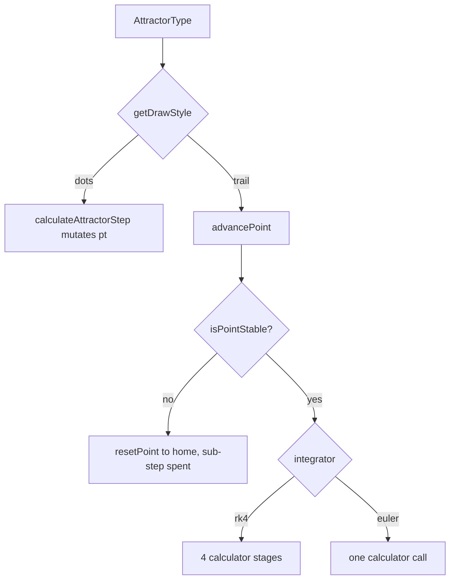

# Attractors

The math. Files in `src/components/attractors/`:
- `attractorCalculations.ts` - classic calculators, merged `calculators` record, `getDrawStyle`, `advancePoint`, `isPointStable`, `resetPoint`, RK4.
- `originalCalculations.ts` - Page 2 calculators.
- `menagerieCalculations.ts` - Page 3 calculators + `MENAGERIE_DRAW_STYLES`; hidden state in WeakMaps.
- `forgeCalculations.ts` - Page 4: base fields, `cover`/`twist`/`invert` operators, `liftToCover`.
- `calculatorTypes.ts` - `Delta`, `AttractorCalculator`, `StepContext`, `DrawStyle`.
- `attractorInfo.ts` - display name, equations, discoverer, LE string, blurb, badge per type (tooltip + tour).
Rosters (params, scale, rotation, center, integrator, home) live in `components/constants.ts`: `createClassicAttractors`, `createOriginalAttractors`, `createMenagerieAttractors`, `createForgeAttractors`, `createInitialAttractors(page)`.

## Contract
```ts
type AttractorCalculator = (pt: Point3D, params: AttractorParams, ctx?: StepContext) => Delta;
// flows:  return { dx: f(pt).x * dt, ... }   (caller adds)
// maps / hidden-state: mutate pt, return { dx: 0, dy: 0, dz: 0 }
```



## Invariants
- Every `params` object has `dt` plus every key its calculator destructures (missing key = NaN).
- `dt = 0` marks a dt-free system; the SPEED slider is disabled and Randomize keeps 0.
- RK4 is only valid for pure calculators (no hidden state, no mutation): set `integrator: 'rk4'` on classics only.
- Hidden-state calculators must guard their own state for non-finite values; `resetPoint` cannot see it.
- Never test `type === 'henon'`; use `getDrawStyle()`.

Topics:
- [classic.md](classic.md) - Page 1 systems, textbook params, RK4.
- [originals.md](originals.md) - Page 2 systems, Euler-tuned.
- [menagerie.md](menagerie.md) - Page 3 classes, hidden state, interaction.
- [forge.md](forge.md) - Page 4 operators, roster, conjugacy invariant.
- [integration.md](integration.md) - `advancePoint`, guard order, RK4 on top of calculators.
- [vetting.md](vetting.md) - the vet script, verdicts, gate.

Related: [../engine/frame.md](../engine/frame.md), [../terminology.md](../terminology.md)
