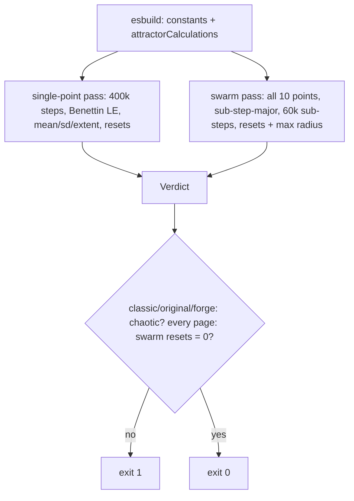

# Vetting

`scripts/vet-attractors.mjs` (`npm run vet:attractors [classic|original|menagerie|forge|all]`, default `original`) bundles the real TypeScript with esbuild and measures every roster entry exactly as the app steps it.



## Verdicts
| Verdict | Rule |
|---------|------|
| UNSTABLE | single-point pass reset at least once |
| n/a | LE not finite (maps without separation, hidden-state systems) |
| chaotic | LE > 0.02 |
| weak | 0 < LE <= 0.02 (fails the gate) |
| not chaotic | LE <= 0 |
| SWARM UNSTABLE | swarm pass reset at least once |

## Gate
- Classics, originals and forge: verdict must be `chaotic`. Forge LE should also equal its base flow's LE.
- All pages including menagerie: swarm resets must be 0.
- Env knobs: `VET_STEPS` (default 400000), `VET_SWARM_STEPS` (default 60000).

## Usage
```bash
npm run vet:attractors all          # full report, exit 1 on any failure
VET_STEPS=100000 npm run vet:attractors classic
```
Copy measured LE into `attractorInfo.ts` (`lyapunov: '≈ 0.20'`) and `center` from the mean column for off-origin orbits.

## Lessons
- The single-point LE pass cannot detect interacting-system blow-ups (a lone body feels no N-body force); that is why the swarm pass exists.
- `weak` used to pass; Ossuary shipped at LE 0.002 that way.

Related: [summary.md](summary.md), [integration.md](integration.md), [menagerie.md](menagerie.md)
