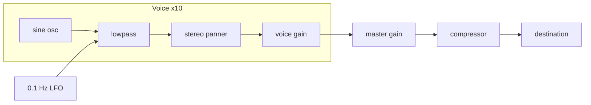

# Audio

Generative synth that sonifies one point per tile. `src/audio/AttractorSynth.ts`, React wrapper `src/hooks/useAttractorSynth.ts`, controls in `AudioPanel`.



## Mapping
Fed from the frame loop every 4 frames with `points[0]` of each tile:
```ts
synth.update(index, { x, y, z });   // x -> pitch (log 200-1200 Hz), y -> pan, z -> cutoff (log 250-4000 Hz)
```

## Invariants
- Starts only on the merge click (browser autoplay gesture rule); muted by default, volume 0.1.
- Ducks while paused (`audio.duck(paused)`).
- Ten voices are allocated at start, which is one reason every page has exactly ten systems.
- Mapping ranges assume roughly unit-to-tens coordinates; systems far off-origin (Wick z≈39) sit at range edges.

Related: [../ui/summary.md](../ui/summary.md), [../engine/frame.md](../engine/frame.md)
