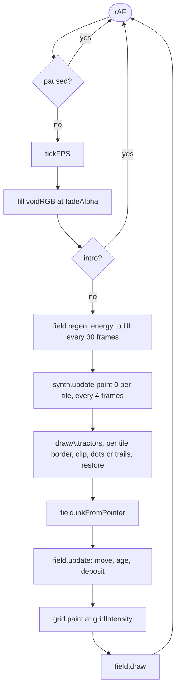

# Frame

One iteration of the rAF loop in `TheVoid.tsx` plus `drawAttractors`. Order matters: strokes, then particles update, then the grid paint, then particles draw on top.



## Sub-step-major stepping (contract)
Every point advances once per sub-step before any point advances again. Interacting calculators (Cluster caches all accelerations at `index === 0`; Murmuration and Colony read neighbours) depend on it.
```ts
for (let step = 0; step < subSteps; step++)
    for (let i = 0; i < points.length; i++) {
        const wasReset = advancePoint(attractor, points[i], { points, index: i });
        // project, store vertex (pathX/pathY/pathBreak), deposit every trailStepInterval
    }
// then one glowing stroke per point from the stored vertices; pathBreak -> moveTo
```
Path buffers are module-level typed arrays grown on demand (`(subSteps + 1) * points` vertices), so no per-frame allocation.

## Dots
`drawDots` steps every `stepInterval` sub-steps (Hénon/Ripple 20 → once per frame at med; Page 3 dust 2), stamps a `henonDotSize` square with glow and deposits `henonGridBoost`.

## Invariants
- Strokes are clipped to the tile; grid deposits are not (bounds-checked against the canvas only), so a system scaled past its tile leaves trails outside it.
- `shadowBlur` is reset to 0 after each trail/dot batch and before the grid pass.
- Glow = `min(tokens.glow, PERF_PRESETS[mode].shadowBlur)`.

## Cost profile
The grid paint (one `fillRect` + string `fillStyle` per live 2 px cell) dominates; physics, including RK4 for 9 classic tiles, is minor. Perf low = 1 sub-step, no glow.

## Lessons
- Point-major order (all sub-steps of point 0, then point 1) silently breaks any interacting system; energy pumping showed up only as bodies streaking out of the Cluster tile.

Related: [summary.md](summary.md), [trail-grid.md](trail-grid.md), [../attractors/menagerie.md](../attractors/menagerie.md)
