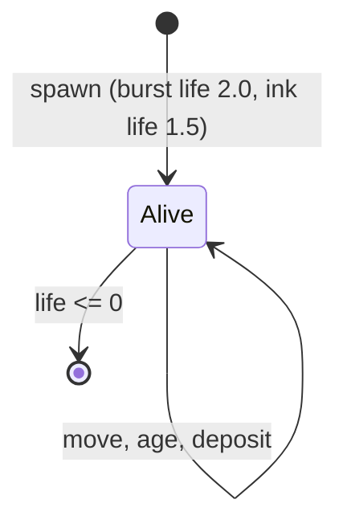

# Particles and Energy

`class ParticleField` in `src/engine/particleField.ts`: short-lived 2D dots and the energy budget that gates pointer ink.

```ts
spawn(x, y, vx, vy, { burst?, color? })   // burst/colour are free; plain ink costs ENERGY_COST, refused below 5
burst(cx, cy)                             // 150 particles, speed 5-20 px/frame, life 2.0
inkFromPointer(pointer)                   // per frame: spawn when pointer moved > 5 px since last ink
releasePointer()                          // pointerout: next move starts a new stroke
regen()                                   // energy = min(100, energy + ENERGY_REGEN)
update(grid)                              // move, life -= 0.01, deposit 0.05, drop dead
draw(ctx, glow, defaultGlowColor)         // radius-2 arcs, alpha = life
```



## Energy budget
0-100, starts 100; +0.1/frame (`ENERGY_REGEN`), -0.5 per ink particle (`ENERGY_COST`); sustainable rate ≈ 0.2 ink/frame (~12/s). Pushed to React every 30 frames and shown in StatsHUD.

## Invariants
- Velocity = 0.5 × input + jitter in [-1, 1]; no damping, particles leave the screen in straight lines.
- Ink velocity input = 0.2 × pointer delta.
- Pointer state comes from window `pointermove` / `pointerout` in `TheVoid.tsx`; `pointerout` bubbles from overlay children, hence `releasePointer`.

Related: [trail-grid.md](trail-grid.md), [frame.md](frame.md)
