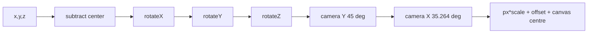

# Projection

`project(x, y, z, attractor, centerX, centerY)` in `src/components/utils/projection.ts`. Orthographic; z is dropped after rotation.



```ts
export const ISO_Y = Math.PI / 4;
export const ISO_X = Math.atan(1 / Math.sqrt(2));
export const FACE_CAMERA: Rotation3D = { x: -ISO_X, y: -ISO_Y, z: 0 };   // cancels the camera for flat systems
```

## Invariants
- `center` (attractor space) is subtracted first so off-origin orbits sit mid-tile; `offset` (screen space) moves the origin to the tile centre.
- Object rotation applies before the camera, X then Y then Z; missing `rotation` = identity.
- With `z = 0`, object Y and camera Y are adjacent and cancel, so `FACE_CAMERA` is the identity view (x right, y screen-vertical, z dropped) and `FACE_CAMERA.x + d` is a pure tilt of d about screen x; `+ pi/2` shows the x-z plane (Page 4 Lantern).
- `scale` = px per model unit; SCALE slider 0.1-100.

## Joystick contract
Horizontal drag adds to `rotation.y`, vertical to `rotation.x`, 0.02 rad/px (`useAttractorRoster.rotate`); arrow keys send 5 px steps to the focused tile. No-op when `rotation` is undefined (Hénon, Ripple) unless Randomize assigned one.

Related: [summary.md](summary.md), [../ui/summary.md](../ui/summary.md)
