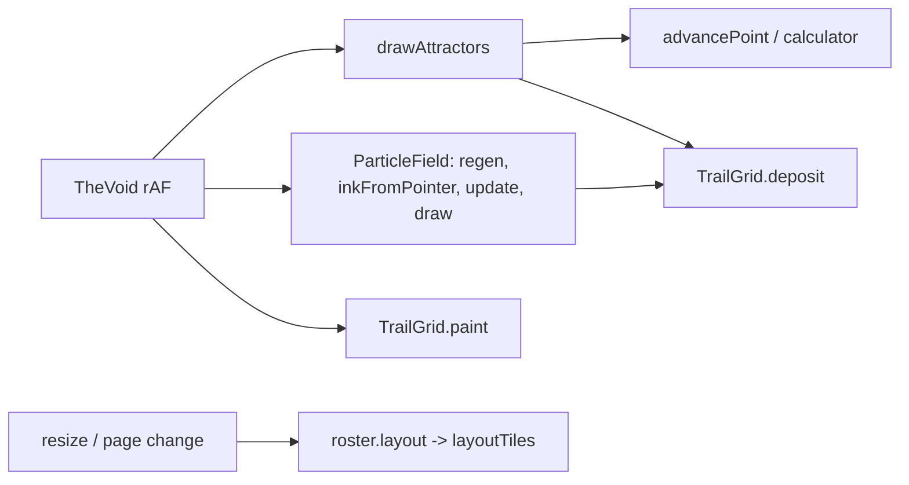

# Engine

Frame-level canvas work, free of React. Files in `src/engine/`, driven from the rAF loop in `TheVoid.tsx`.

| File | Export | Job |
|------|--------|-----|
| `drawAttractors.ts` | `drawAttractors(ctx, attractors, grid, opts)` | step + draw every attractor for one frame |
| `trailGrid.ts` | `class TrailGrid` | persistent decaying intensity buffer |
| `particleField.ts` | `class ParticleField` | merge burst, pointer ink, energy |
| `layout.ts` | `layoutTiles(attractors, w, h, cols)` | tile rects + projection offsets |
Projection is `components/utils/projection.ts`; theme values come from `utils/themeTokens.ts`.



## Layout
```ts
// LAYOUT: marginX 20, marginTop 30, marginBottom 20, gap 30; cols mobile 2 / tablet 3 / desktop 5
attractor.rect = { x, y, w: cellW, h: cellH };
attractor.offset = { x: x + cellW / 2 - width / 2, y: y + cellH / 2 - height / 2 };
```

## Invariants
- The canvas is sized to the CSS viewport, not DPR-scaled.
- Resize and page change reallocate the trail buffer (trails are lost).
- The engine never holds a reference to an attractor across frames, so swapping the roster mid-animation is safe.

Topics:
- [frame.md](frame.md) - frame order, sub-step-major stepping, path buffering.
- [trail-grid.md](trail-grid.md) - buffer layout, deposit/decay math, flush.
- [particles.md](particles.md) - burst, pointer ink, energy budget.
- [projection.md](projection.md) - object rotation, isometric camera, center/offset.

Related: [../attractors/integration.md](../attractors/integration.md), [../ui/summary.md](../ui/summary.md)
