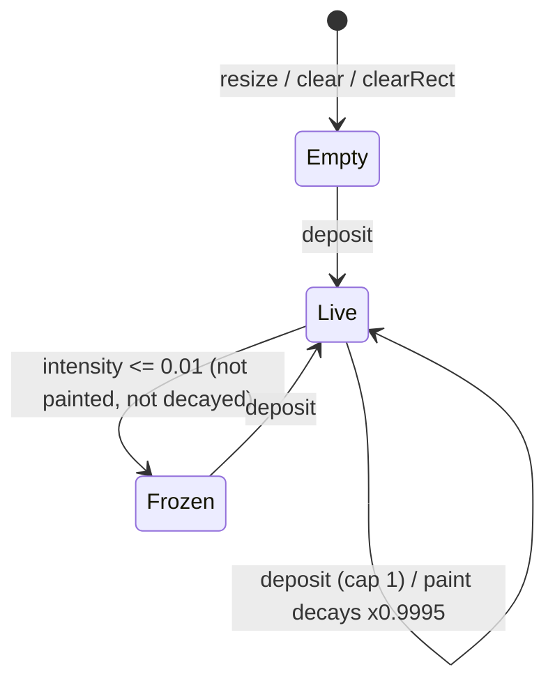

# Trail Grid

`class TrailGrid` in `src/engine/trailGrid.ts`. Persistent intensity buffer that turns transient strokes into long-lived trails.

```ts
cols = ceil(width / GRID_SIZE); rows = ceil(height / GRID_SIZE);   // GRID_SIZE = 2
cells: Float32Array(cols * rows)      // intensity 0..1, index = gx * rows + gy (column-major)
colors: (RGB | null)[]                // last deposited colour; null -> INK_COLOR (80,80,80)
```



## API
| Method | Behaviour |
|--------|-----------|
| `resize(w, h)` | reallocate; trails lost |
| `deposit(px, py, amount, color?)` | canvas px -> cell, add, cap 1; colour kept if omitted |
| `clearRect(rect)` | zero cells under a tile (inclusive, clamped) - Flush |
| `clear()` | zero everything - Reset / page change |
| `paint(ctx, alphaScale)` | paint live cells at `intensity * alphaScale`, decay in the same pass |

## Deposit sources
| Source | Amount | When | Colour |
|--------|--------|------|--------|
| trail point | `trailGridBoost` 0.05 | every `trailStepInterval` (2) sub-steps | point colour |
| dot | `henonGridBoost` 0.1 | each stamp | point colour |
| particle | 0.05 | every frame alive | none |

## Numbers
Half-life ≈ 1386 frames (~23 s at 60 fps); 1.0 to the 0.01 cutoff ≈ 9200 frames (~2.5 min). Painted alpha is the pre-decay value.

## Lessons
- Flat typed array replaced nested `number[][]` (one allocation, cache-friendly, `fill` for clear). Keep column-major indexing consistent across methods.

Related: [frame.md](frame.md), [particles.md](particles.md)
