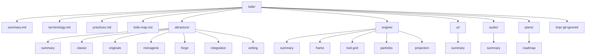

# Lode Map

- [summary.md](summary.md) - one-paragraph snapshot of the app
- [terminology.md](terminology.md) - domain terms (page, roster, advancePoint, sub-step-major, verdicts, ...)
- [practices.md](practices.md) - refs vs state, one step function, vet-before-ship, canvas hygiene, Tailwind config
- [lode-map.md](lode-map.md) - this index
- attractors/ - `src/components/attractors/`, rosters in `constants.ts`, `scripts/vet-attractors.mjs`
  - [attractors/summary.md](attractors/summary.md) - calculator contract, file map, invariants
  - [attractors/classic.md](attractors/classic.md) - Page 1: textbook params, RK4, R-F basin
  - [attractors/originals.md](attractors/originals.md) - Page 2: Euler-tuned originals
  - [attractors/menagerie.md](attractors/menagerie.md) - Page 3: ten classes, hidden state, interaction
  - [attractors/forge.md](attractors/forge.md) - Page 4: cover/twist/inversion operators, roster, conjugacy
  - [attractors/integration.md](attractors/integration.md) - advancePoint, guard order, RK4
  - [attractors/vetting.md](attractors/vetting.md) - vet script, verdicts, gate
- engine/ - `src/engine/`, `components/utils/projection.ts`
  - [engine/summary.md](engine/summary.md) - modules, layout, invariants
  - [engine/frame.md](engine/frame.md) - frame order, sub-step-major contract, path buffers
  - [engine/trail-grid.md](engine/trail-grid.md) - TrailGrid buffer, deposit/decay, flush
  - [engine/particles.md](engine/particles.md) - ParticleField, burst, pointer ink, energy
  - [engine/projection.md](engine/projection.md) - rotation, isometric camera, center/offset
- ui/ - overlay components and state hooks
  - [ui/summary.md](ui/summary.md) - roster hook, page change, keyboard, export, theme
- audio/ - `src/audio/`, `useAttractorSynth`
  - [audio/summary.md](audio/summary.md) - voice graph, mapping, gesture start
- plans/
  - [plans/roadmap.md](plans/roadmap.md) - open decisions and code-observed gaps
- tmp/ - session scraps, git-ignored (only `.gitignore` tracked)
