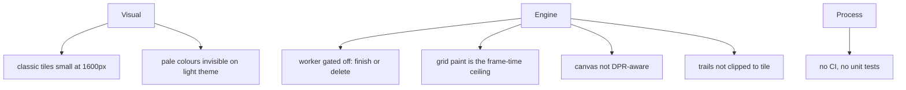

# Roadmap and Open Decisions

Nothing here is decided. Items are code-observed gaps awaiting a human call.

Full prioritised backlog: [`docs/IDEAS.md`](../../docs/IDEAS.md) (waves 5-8, nothing implemented). Below are the code-observed gaps it builds on.

## Branch state
- Waves 1-4 are merged to `main` (merge commits). `75aba4e` (tap-to-control) was reverted on Wave 1; touch-only reintroduction is IDEAS B1.
- `9df1d12` still carries a `Co-Authored-By` trailer in `main` history; removing it would mean rewriting `main`, so it stays.

## Visual
- Classic attractors occupy a small fraction of their tiles at 1600x900 (scale values predate the responsive grid). Consider per-tile auto-fit from vet extent.
- Light theme: white (Lorenz) and pale colours are near-invisible; needs per-theme colour mapping.

## Engine
- Worker (`USE_WORKER = false`): no `StepContext` in its protocol (Page 3 impossible), not re-inited on page change, buffers not wired into drawing.
- Grid paint O(cols*rows) per frame with string `fillStyle`; candidate: `ImageData` write from the Float32Array.
- Canvas not DPR-scaled (blurry on HiDPI).
- Trail deposits are not clipped to the tile; oversized systems bleed into neighbours.
- SPEED slider shares one range (0.001-0.03) across systems vetted at very different dt; Euler originals pushed to 0.03 may diverge (now reset cleanly, but look wrong).

## Process
- No CI and no unit tests; gates run by hand (IDEAS A1, A2).

## Docs
- `AGENTS.md` still describes the pre-refactor single-component architecture and `@tailwindcss/vite`.

Related: [../summary.md](../summary.md)
