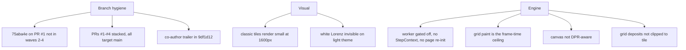

# Roadmap and Open Decisions

Nothing here is decided. Items are code-observed gaps awaiting a human call.

## Branch hygiene
- Commit `75aba4e` (control panels with toggled state, intro merge flow) exists only on PR #1's branch and touches files Waves 2-4 rewrote. Cherry-pick or drop.
- PRs #1-#4 are stacked but all target `main`; merging #4 merges everything. Close #1-#3 after, or retarget.
- `9df1d12` carries a `Co-Authored-By` trailer (repo convention: none). Removing it rewrites history.

## Visual
- Classic attractors occupy a small fraction of their tiles at 1600x900 (scale values predate the responsive grid). Consider per-tile auto-fit from vet extent.
- Light theme: white (Lorenz) and pale colours are near-invisible; needs per-theme colour mapping.

## Engine
- Worker (`USE_WORKER = false`): no `StepContext` in its protocol (Page 3 impossible), not re-inited on page change, buffers not wired into drawing.
- Grid paint O(cols*rows) per frame with string `fillStyle`; candidate: `ImageData` write from the Float32Array.
- Canvas not DPR-scaled (blurry on HiDPI).
- Trail deposits are not clipped to the tile; oversized systems bleed into neighbours.
- SPEED slider shares one range (0.001-0.03) across systems vetted at very different dt; Euler originals pushed to 0.03 may diverge (now reset cleanly, but look wrong).

## Docs
- `AGENTS.md` still describes the pre-refactor single-component architecture and `@tailwindcss/vite`.

Related: [../summary.md](../summary.md)
