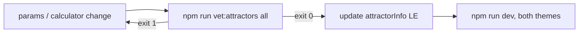

# Practices

Conventions observed in the code. Follow them unless a decision changes them.

## Simulation state in refs and engine objects, UI state in React
The frame loop mutates the roster ref, `TrailGrid` and `ParticleField` directly. React state holds only what the overlay renders. Values the loop needs from React are mirrored into one `live` ref:
```ts
const live = useRef({ paused, intro, theme, perfMode, page, synth: audio.synth });
useEffect(() => { live.current = { paused, intro, theme, perfMode, page, synth: audio.synth }; }, [...]);
```
Engine objects are created once with `useState(() => new TrailGrid())`, never `useRef(new ...)` (that constructs every render).

## Controls write the ref first, then patch the snapshot
`useAttractorRoster` handlers mutate `attractors.current[i]` and then patch `overlayItems` / `speeds`. The simulation never waits on a render.

## Keep `.current` reads inside the hook that owns the ref
The React Compiler lint (`react-hooks/preserve-manual-memoization`) cannot see that a ref returned from a custom hook is a ref. Expose intent-level callbacks (`layout`, `rectOf`) from the owning hook instead of reading `roster.attractors.current` in `useCallback`s elsewhere.

## One step function
All continuous stepping goes through `advancePoint()` (render loop, worker, vet). Never inline `calc + guard + add` again; the guard order is the contract. See [attractors/integration.md](attractors/integration.md).

## Sub-step-major stepping
Interacting calculators assume every point advances once per sub-step. See [engine/frame.md](engine/frame.md).

## Vet before shipping parameters
Any change to a calculator, params, dt, integrator or initial points: run `npm run vet:attractors all`. It exits 1 on failure. Copy measured LE into `attractorInfo.ts`.



## Canvas hygiene
- Clip per tile: `save → beginPath → rect → clip → draw → restore`.
- Reset `shadowBlur = 0` after glow work; the grid pass runs with no blur.
- Partial clear with the theme's `fadeAlpha` each frame (motion trails), never a full clear.
- Read theme values via `getThemeTokens(theme)` each frame; canvas cannot read Tailwind.

## Code layout
- `components/` React UI + `constants.ts`, `types.ts`; `components/attractors/` math; `engine/` frame-level canvas work; `hooks/` state; `utils/` palettes, export, theme tokens, randomizer; `workers/` gated physics worker; `audio/` synth.
- `import type` for type-only imports (`verbatimModuleSyntax`); TS strict, `noUnusedLocals/Parameters`.
- localStorage access is wrapped in try/catch (`usePersistentState`).

## Styling
Tailwind v4 via `@tailwindcss/postcss`; `src/index.css` must keep `@import "tailwindcss"` + `@config "../tailwind.config.js"` or every custom class (z-index scale, `text-label`, `ink-*` colours) silently disappears. Theme colours are CSS variables mapped in the JS config.

## Repo conventions
- Commits use short `feat:` / `fix:` / `docs:` prefixes; no co-author lines.
- User-facing docs: `README.md`, `docs/` (ARCHITECTURE, WALKTHROUGH, CHANGELOG, sessions/), `CLAUDE.md`, `CHECKPOINT.md`. The Lode is the AI's current-state memory; history goes in CHANGELOG or `lode/tmp/`.
- Verification: `npx tsc -b`, `npm run lint`, `npm run build`, `npm run vet:attractors all`, visual check in a browser.

Related: [engine/summary.md](engine/summary.md), [ui/summary.md](ui/summary.md)
