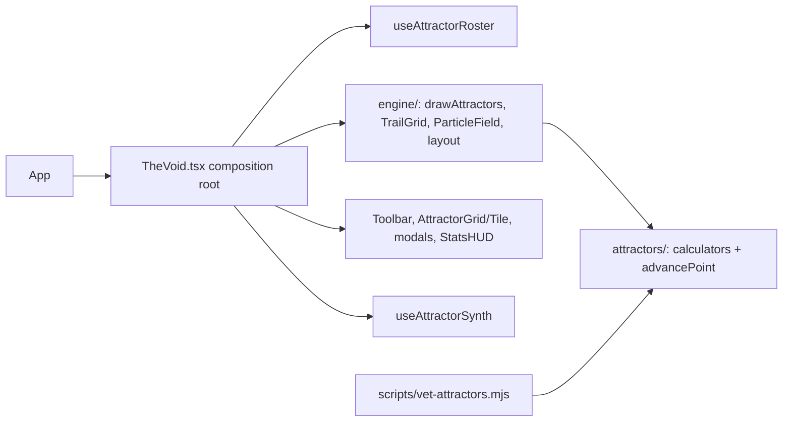

# Summary

The Record is a client-only React 19 + TypeScript + Vite app that renders 40 dynamical systems on one full-viewport 2D canvas, ten at a time across four pages: **classic** (textbook chaotic attractors, RK4), **original** (ten flows invented for the project, forward Euler, vetted numerically) and **menagerie** (ten different classes of dynamics: IFS, Julia set, Langton's ants, billiard, double pendulum, N-body, delay equation, boids, quasi-periodic, impact oscillator) and **forge** (known chaotic flows reshaped by n-fold covers, twists and spherical inversion, RK4). `src/components/TheVoid.tsx` is the composition root: it owns the canvas and a `requestAnimationFrame` loop that calls the engine (`src/engine/`) to step every attractor sub-step-major, project it through a per-attractor rotation plus a fixed isometric camera, stroke glowing trails (or stamp dots) clipped to a responsive 2/3/5-column tile grid, and deposit into a decaying trail buffer. A React overlay provides per-tile controls (rotation joystick, scale, speed, points, colour, flush, randomize) and a global toolbar (pause, reset, page 1/2/3/4, palette, perf preset, PNG/WebM export, tour, theme, stats, help) with keyboard shortcuts; a generative Web Audio synth sonifies one point per tile. `npm run vet:attractors` measures every system's Lyapunov exponent and whole-swarm stability exactly as the app integrates it. No backend, no persistence beyond localStorage settings, no unit tests.

Related: [lode-map.md](lode-map.md), [attractors/summary.md](attractors/summary.md), [engine/summary.md](engine/summary.md), [ui/summary.md](ui/summary.md), [audio/summary.md](audio/summary.md)
