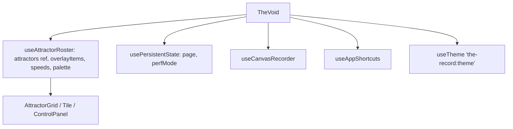

# UI

React overlay above the canvas. `TheVoid.tsx` composes it; state hooks live in `src/hooks/`.

| Piece | Role |
|-------|------|
| `AttractorGrid` → `AttractorTile` → `Joystick`, `ControlPanel`, `InfoTooltip` | per-tile controls, revealed on hover/focus |
| `Toolbar` | pause, reset, randomize all, page 1/2/3/4, palette, perf, PNG, REC, tour, theme, stats, help |
| `StatsHUD` | FPS, total points, energy bar, phase |
| `IntroOverlay`, `PausedOverlay`, `HelpModal`, `TourModal`, `AudioPanel`, `ErrorBoundary` | modes and modals |



## useAttractorRoster
Owns the live roster ref and its React snapshot. Handlers write the ref, then patch the snapshot: `rotate`, `setScale`, `setSpeed`, `changePoints` (1-50), `setColor`, `randomize`, `randomizeAll`, `applyPalette`, plus `layout(w, h, cols)`, `rectOf(i)`, `replace(fresh)`.
```ts
speedAdjustable: a.params.dt > 0   // false for maps / chaos game -> SPEED slider disabled, shows 'map'
```
Randomize: random colour and rotation, scale 0.5x-1.5x, dt 0.5x-1.5x of current (clamped 0.001-0.03, dt 0 stays 0).

## Page change
`handlePageChange(next)` → `roster.replace(createInitialAttractors(next))`, reset focused tile and tour index, phase label, clear trails/particles, `resizeCanvas()` (re-layout + overlay sync). The worker is not re-initialised.

## Keyboard (useAppShortcuts)
Space pause · Esc close help/tour else reset · ?/H help · S stats · T theme · N tour · R randomize all · P PNG · V record · M mute · 1/2/3/4 page (no modifiers) · -/= points on focused tile · arrows rotate focused tile (tour nav wins while open). Shortcuts ignore typing in inputs except Escape.

## Export
PNG snapshot (`snapshotPNG`); WebM via `canvas.captureStream` + `MediaRecorder`, 60 s soft cap, elapsed label every 500 ms, blob auto-downloaded.

## Invariants
- The tile root is `pointer-events: none` (canvas stays reachable) and children inherit it; every interactive region must opt back in with `pointer-events-auto` (title, reveal container). Missing it makes the control hit-test transparent: hover drops, the panel fades, input hits the canvas.
- `rotate` patches `overlayItems[i].rotation` with a copy so the joystick needle re-renders.
- Click anywhere except `[data-no-merge]` (toolbar, audio panel) during intro triggers merge.
- Theme: stored key `the-record:theme`, else `prefers-color-scheme`. Pale colours vanish on light theme (white Lorenz).

Related: [../engine/summary.md](../engine/summary.md), [../audio/summary.md](../audio/summary.md), [../practices.md](../practices.md)
